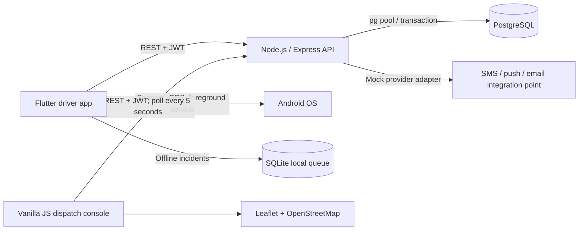

# RESQDRIVE

Smartphone-based vehicle accident detection and emergency response prototype. The repository follows the numbered build tasks in `tasks/`; the mobile sensor, notifications, and emergency service behavior are educational prototypes and require on-device safety testing before any real-world use.

## Architecture

## Components

- [Mobile app](mobile/README.md): Flutter, Provider, Dio, sensors_plus, geolocator, foreground task, secure storage, and SQLite retry queue.
- [Backend API](backend/README.md): Express, JWT/bcrypt, Joi, PostgreSQL, mock notifications, and Postman collection.
- [Dispatcher console](dispatcher/index.html): responsive browser dashboard with Leaflet/OpenStreetMap and live incident polling.
- [Database design](docs/database-design.md): normalized schema, ER diagram, seed data, indexes, audit trigger, dispatch view, procedure, and sample queries.
- [Initial mobile prototype](index.html): standalone HTML demo with sign-in, dashboard, incident flow, contacts, vehicles, history, and settings.

## OS Concepts

- Sensor sampling: accelerometer and gyroscope streams sampled at approximately 50 Hz; filtered acceleration and a two-second rolling window drive crash checks.
- Background execution: Android foreground service and persistent notification keep monitoring visible while the app is backgrounded.
- Scheduling and timers: service repeat events keep the notification current; the crash confirmation screen uses a configurable countdown.
- Permissions and battery: runtime location, activity recognition, notification, full-screen intent, and battery-exemption prompts are wired for Android.
- Inter-process communication: the foreground task isolate sends crash data to the Flutter UI through the plugin's task communication port.
- Offline work: SQLite stores incident, cancel, and escalation requests and retries when connectivity returns.

## DBMS Concepts

- Third normal form: users, vehicles, contacts, trips, sensor events, accidents, and alert delivery have separate keyed tables.
- Referential integrity: foreign keys specify cascade, restrict, and set-null deletion behavior; checks constrain coordinates, status values, channels, and priorities.
- Transactions: accident and per-contact alert rows are created together; the application wraps the procedure call and status change in a transaction.
- Trigger and audit log: each accident insert/update stores old/new row snapshots with an action and timestamp.
- Indexes: owner, status, timestamp, and incident/contact relationships have query-targeted indexes.
- View and aggregation: `dispatch_active_accidents` provides denormalized live dispatcher rows; example aggregate and subquery reports are in the database design doc.

## Setup

### PostgreSQL and API

1. Install PostgreSQL 14+ and Node.js 18+.
2. Create the database `resqdrive`.
3. From the repository root, apply `backend/db/schema.sql`, then `backend/db/seed.sql` with `psql -d resqdrive -f <file>`.
4. Copy `backend/.env.example` to `backend/.env`; set a database URL and a private random JWT secret of at least 32 characters.
5. In `backend/`, run `npm install`, then `npm run dev`.
6. Register a driver using `POST /api/auth/register`. Dispatcher accounts must be provisioned in `dispatch_users` with a bcrypt password hash.

### Flutter app

1. Install Flutter 3.44+ / Dart 3.12+ and Android Studio.
2. Generate platform scaffolding if needed: in `mobile/`, run `flutter create --platforms=android,ios .` and retain the Android permission/service entries already in the manifest.
3. Run `flutter pub get`, then `flutter run --dart-define=API_BASE_URL=http://10.0.2.2:3000/api` on the Android emulator.
4. The `Explore demo` option runs the UI without an API account. Real monitoring and permissions require a physical Android device for meaningful validation.

### Dispatcher

Serve `dispatcher/` with a local static web server and open its `index.html`. The login form accepts the API URL; the API's CORS configuration must allow the dashboard origin. OpenStreetMap tiles and Leaflet are loaded from their public services.

## Tests

From `backend/`, run `npm test` for API checks. To run the integration test for the trigger/procedure against a database initialized with the schema, set `DATABASE_URL` and run `npm run test:db`. The procedure test wraps fixture rows in a transaction and rolls them back.

From `mobile/`, run `flutter test`. Crash detection tests use simulated sensor samples and do not require device hardware.

## Screenshots

Capture current-device screenshots after running the Flutter app and dispatcher console. Suggested captures: `mobile-dashboard.png`, `mobile-crash-alert.png`, `mobile-sos-confirmation.png`, and `dispatcher-active-incidents.png`. No screenshot images are checked in yet.