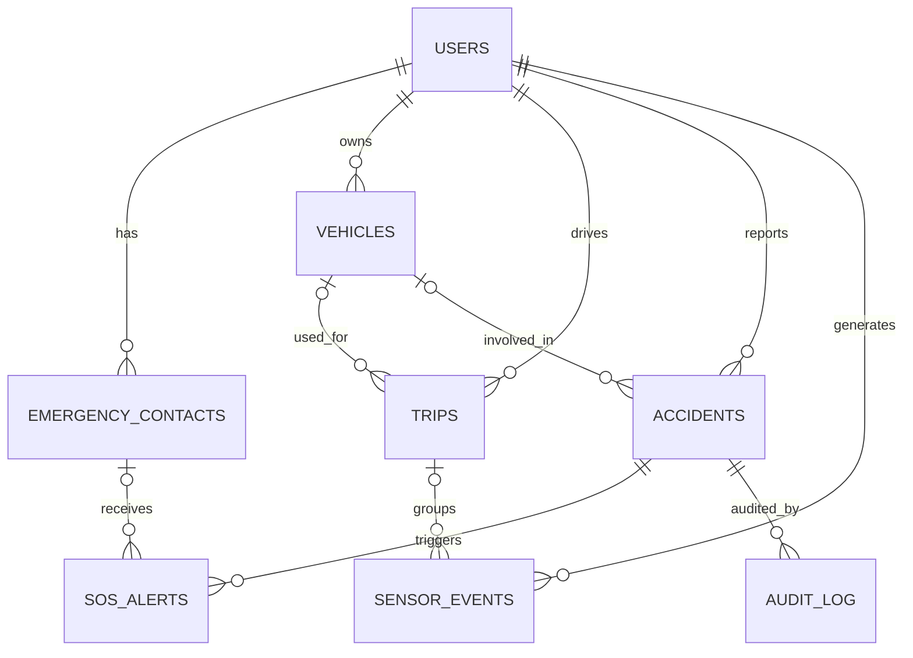

# RESQDRIVE Database Design

The PostgreSQL schema and repeatable sample data are in `backend/db/schema.sql` and `backend/db/seed.sql`.

The design separates user-owned contacts, vehicles, trips, sensor samples, incidents, and per-contact notifications. Repeated contact, vehicle, and user attributes are stored once and referenced by keys. `sos_alerts` relates an incident to each notified contact and records delivery independently, keeping the core entities in 3NF.

`create_accident_with_sos` inserts an accident and one pending alert per emergency contact. Call it as one PostgreSQL `CALL`; the call runs transactionally, and any constraint or trigger failure aborts both incident and alert inserts. When composing it with other writes, the application can wrap the call in an explicit transaction.

## ER Diagram



## Sample Queries

```sql
-- 1. Accident history with driver and optional vehicle details.
SELECT a.id, a.detected_at, a.status, a.latitude, a.longitude,
       u.full_name AS driver, v.plate_number, v.model
FROM accidents AS a
JOIN users AS u ON u.id = a.user_id
LEFT JOIN vehicles AS v ON v.id = a.vehicle_id
WHERE a.user_id = $1
ORDER BY a.detected_at DESC;

-- 2. Active dispatch incidents, including notified contact and delivery state.
SELECT *
FROM dispatch_active_accidents
ORDER BY detected_at ASC;

-- 3. Alert counts and successful delivery totals by channel.
SELECT channel, count(*) AS total,
       count(*) FILTER (WHERE delivery_status IN ('SENT', 'DELIVERED')) AS successful
FROM sos_alerts
GROUP BY channel
ORDER BY total DESC;

-- 4. Users with more incidents than the average user.
SELECT u.id, u.full_name, count(a.id) AS incident_count
FROM users AS u
JOIN accidents AS a ON a.user_id = u.id
GROUP BY u.id, u.full_name
HAVING count(a.id) > (
    SELECT avg(user_incidents.incident_count)
    FROM (
        SELECT count(*) AS incident_count
        FROM accidents
        GROUP BY user_id
    ) AS user_incidents
);

-- 5. Full notification trail for an incident, including contacts later removed.
SELECT sa.id, sa.channel, sa.sent_at, sa.delivery_status,
       ec.full_name AS contact_name, ec.phone, ec.email
FROM sos_alerts AS sa
LEFT JOIN emergency_contacts AS ec ON ec.id = sa.contact_id
WHERE sa.accident_id = $1
ORDER BY sa.created_at, sa.id;
```

## Seed Notes

Seed user: `alex@example.test`. The password hash is deliberately an invalid placeholder; seed data does not provide a login credential. Replace it with an application-generated bcrypt hash for a local authentication demo.